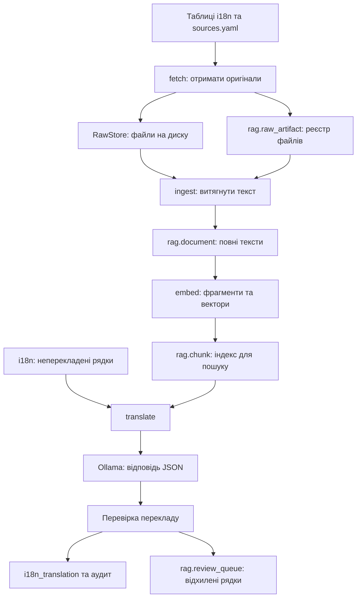

# Як влаштований text-resource-translator

Це посібник для читання поточної реалізації проєкту. Він пояснює призначення файлів,
основні класи й функції, рух даних і те, що відбувається після запуску команд у терміналі.
Приклади перекладу нижче ілюстративні: модель може обрати інше формулювання.

## Зміст

1. [Що робить проєкт](#1-що-робить-проєкт)
2. [З чого почати читання](#2-з-чого-почати-читання)
3. [Карта файлів](#3-карта-файлів)
4. [База даних і моделі](#4-база-даних-і-моделі)
5. [Запуск, конфігурація й транзакції](#5-запуск-конфігурація-й-транзакції)
6. [Отримання джерел і збереження оригіналів](#6-отримання-джерел-і-збереження-оригіналів)
7. [Парсинг та імпорт документів](#7-парсинг-та-імпорт-документів)
8. [Фрагменти, вкладення і пошук](#8-фрагменти-вкладення-і-пошук)
9. [Переклад: детальний розбір](#9-переклад-детальний-розбір)
10. [Планувальник і логування](#10-планувальник-і-логування)
11. [Інфраструктура, міграції та приклади](#11-інфраструктура-міграції-та-приклади)
12. [Тести](#12-тести)
13. [Проходження одного рядка через програму](#13-проходження-одного-рядка-через-програму)
14. [Як читати використані конструкції Python](#14-як-читати-використані-конструкції-python)
15. [Практичні команди й SQL](#15-практичні-команди-й-sql)
16. [Межі поточної реалізації](#16-межі-поточної-реалізації)

## 1. Що робить проєкт

Проєкт автоматизує переклад коротких текстів програмного інтерфейсу: кнопок,
заголовків, повідомлень про помилки, підказок і статусів.

Наприклад, у базі є ключ `demo.settings.save` з англійським текстом `Save changes`.
Програма знаходить, що українського перекладу ще немає, передає рядок моделі,
перевіряє відповідь і записує результат на кшталт `Зберегти зміни`.

Для узгодженості термінів вона може додавати до запиту приклади наявних перекладів,
фрагменти глосарію та правила стилю. Такий підхід називається **RAG**:
спочатку знайти потрібну довідкову інформацію, потім передати її моделі разом із завданням.

У поточній локальній конфігурації беруть участь три окремі процеси:

| Компонент | Для чого потрібен |
| --- | --- |
| Python-програма `trt` | Організовує отримання даних, пошук, запити до моделі та запис результатів |
| PostgreSQL із pgvector | Зберігає тексти, переклади, документи, вектори та службові записи |
| Ollama з `qwen3.5:9b` | Генерує переклади через локальний HTTP API |

**У проєкті дві різні ролі моделей.** `qwen3.5:9b` перекладає текст.
`intfloat/multilingual-e5-base` перетворює текст на числові вектори для пошуку.
Завантаження файлів із Hugging Face під час побудови RAG стосується другої моделі.

### Загальний рух даних



`trt translate` може працювати й без наповненого RAG-індексу. Тоді модель отримує
рядки та загальні правила, а контекст із попередніх перекладів не додається.

## 2. З чого почати читання

Рекомендований порядок, щоб швидше зрозуміти зв'язки між файлами:

1. `src/trt/cli.py` — які команди можна запускати.
2. `src/trt/pipeline.py` — як команди викликають етапи роботи.
3. `src/trt/config.py` — звідки беруться параметри.
4. `src/trt/models.py` — що зберігається в базі.
5. `src/trt/translate/translator.py` — основний алгоритм перекладу.
6. `src/trt/translate/prompt.py` — що саме отримує модель.
7. `src/trt/translate/validation.py` і `writeback.py` — перевірка й запис.
8. `sources/`, `ingest/`, `extract/`, `embeddings.py`, `vector_store.py` — підготовка RAG.

Під час першого читання корисно простежити одну команду:

```text
trt translate --locale uk --limit 20 --dry-run
    → cli.translate()
    → pipeline.step_translate()
    → Translator.translate_locale()
    → select_work()
    → build_contexts()
    → build_messages()
    → Translator._call()
    → validate_translation()
    → друк результату в термінал
```

## 3. Карта файлів

```text
text-resource-translator/
├── README.md                         Короткий запуск та налаштування
├── PROJECT_GUIDE_UK.md               Цей посібник
├── PLAN.md                           Початковий архітектурний план
├── LICENSE                           Ліцензія MIT
├── pyproject.toml                    Залежності, пакет і команда trt
├── .env.example                      Приклад налаштувань
├── .env                              Локальні параметри запуску
├── .gitignore                        Що не потрапляє в Git
├── Dockerfile                        Образ Python-застосунку
├── docker-compose.yml                PostgreSQL і застосунок у контейнерах
├── sources.yaml                      Перелік ресурсів і довідкових документів
├── alembic.ini                       Налаштування міграцій
├── alembic/
│   ├── env.py                        Підключення Alembic до моделей і бази
│   ├── script.py.mako                Шаблон нової міграції
│   └── versions/
│       ├── 0001_i18n_schema.py        Таблиці локалізації
│       ├── 0002_rag_schema.py         RAG-таблиці та векторні індекси
│       └── 0003_raw_artifact.py       Реєстр отриманих оригіналів
├── sql/
│   ├── seed_i18n.sql                 Малий демонстраційний набір
│   └── seed_i18n_large.sql           100 додаткових рядків
├── samples/                          Приклади JSON, properties, глосарій і PDF
├── src/trt/
│   ├── __init__.py                   Версія пакета
│   ├── cli.py                        Команди термінала
│   ├── config.py                     Конфігурація
│   ├── db.py                         З'єднання й транзакції
│   ├── models.py                     ORM-моделі таблиць
│   ├── pipeline.py                   Послідовність етапів
│   ├── scheduler.py                  Періодичний запуск
│   ├── logging.py                    Формат логів
│   ├── chunking.py                   Розбиття на фрагменти
│   ├── embeddings.py                 Моделі вкладень і кеш
│   ├── vector_store.py               Векторний індекс і пошук
│   ├── sources/
│   │   ├── __init__.py
│   │   ├── base.py                   Загальні структури джерел
│   │   ├── postgres_i18n.py          Отримання текстів із PostgreSQL
│   │   └── resource_files.py         Отримання локальних та HTTP-файлів
│   ├── storage/
│   │   ├── __init__.py
│   │   └── raw_store.py              Зберігання оригінальних байтів
│   ├── extract/
│   │   ├── __init__.py
│   │   ├── resource_parsers.py       Парсери файлів інтерфейсу
│   │   └── document_text.py          Витягування тексту документів
│   ├── ingest/
│   │   ├── __init__.py
│   │   └── documents.py              Завантаження тексту в rag.document
│   └── translate/
│       ├── __init__.py
│       ├── prompt.py                 Структура запиту та відповіді
│       ├── translator.py             Алгоритм перекладу
│       ├── validation.py             Перевірки відповіді
│       └── writeback.py              Запис перекладів, аудиту й review
└── tests/                            Автоматичні перевірки
```

`.venv/` містить інтерпретатор Python і встановлені бібліотеки. `data/raw/` створюється
під час отримання джерел. Це робочі каталоги, вони не є основним кодом проєкту.

## 4. База даних і моделі

### `src/trt/models.py`

Файл описує таблиці через SQLAlchemy ORM. Клас Python відповідає таблиці,
а атрибут із `mapped_column()` — колонці. `Base` є спільною основою цих класів.

Наприклад:

```python
class I18nLocale(Base):
    __tablename__ = "i18n_locale"
    locale_code: Mapped[str] = mapped_column(String(16), primary_key=True)
```

Це опис таблиці `i18n_locale`, у якій `locale_code` — текстовий первинний ключ.
Сам опис класів не створює таблиці автоматично: це роблять міграції.

### Продуктові таблиці `i18n_*`

| Клас | Таблиця | Що містить |
| --- | --- | --- |
| `I18nLocale` | `public.i18n_locale` | Коди мов, назви мов і ознаку `enabled` |
| `I18nText` | `public.i18n_text` | Ідентифікатор рядка, стабільний ключ і тип елемента |
| `I18nTranslation` | `public.i18n_translation` | Текст конкретною мовою та час оновлення |

У `i18n_text` немає колонки з англійським оригіналом. Англійський текст також лежить
у `i18n_translation`, із `locale_code = 'en'`.

Приклад зв'язку:

```text
i18n_text:
  text_id = 42
  text_code = demo.settings.save
  owner_kind = button

i18n_translation:
  text_id = 42, locale_code = en, translated_text = Save changes
  text_id = 42, locale_code = uk, translated_text = Зберегти зміни
```

`text_id` пов'язує мовні варіанти одного рядка. `text_code` — його зрозумілий людині
ключ. `translation_id` — ідентифікатор окремого мовного запису.

Унікальність `(text_id, locale_code)` не дозволяє зберегти два актуальні переклади
одного рядка тією самою мовою. Час `date_updated` використовується для визначення
застарілих перекладів і для інкрементального отримання даних.

### Службові таблиці `rag.*`

`rag` — окрема схема всередині тієї самої бази PostgreSQL.

| Клас | Таблиця | Основні дані |
| --- | --- | --- |
| `RagRawArtifact` | `rag.raw_artifact` | Джерело, назва, шлях до оригіналу, SHA-256, метадані, час отримання та імпорту |
| `RagDocument` | `rag.document` | Повний текст, `doc_key`, тип, мова, посилання на оригінал і хеші вмісту |
| `RagChunk` | `rag.chunk` | Фрагмент, його вектор, модель вкладень і зв'язок із документом |
| `RagEmbeddingCache` | `rag.embedding_cache` | Вектор для пари «хеш тексту + назва моделі» |
| `RagSyncState` | `rag.sync_state` | Курсори останнього отримання даних і HTTP-метадані |
| `RagTranslationAudit` | `rag.translation_audit` | Модель перекладу, хеш запиту та ID підібраних фрагментів |
| `RagReviewQueue` | `rag.review_queue` | Джерело, невдалий варіант і причина відхилення |

`RagDocument.kind` має два значення: `ui_string` для рядка інтерфейсу та
`reference_doc` для довідкового документа.

У документа є два хеші:

- `content_sha256` показує, який текст зараз збережений.
- `chunked_sha256` показує, для якої версії тексту вже побудовано фрагменти.

Якщо вони різні, `embed_pending()` знає, що векторний індекс треба оновити.

Вектор зберігається як `Vector(EMBEDDING_DIM)`. Розмірність фіксується у схемі БД
під час створення колонок. Зміна `.env` сама по собі не змінює тип уже створеної колонки.

## 5. Запуск, конфігурація й транзакції

### `pyproject.toml`: звідки береться команда `trt`

Файл задає назву пакета, Python `>=3.12`, залежності й параметри інструментів.
Ключовий рядок:

```toml
[project.scripts]
trt = "trt.cli:app"
```

Після встановлення пакета команда `trt` запускає об'єкт `app` із `src/trt/cli.py`.
Встановлення `pip install -e ...` робить пакет редагованим: зміни у `src/` підхоплюються
наступним запуском команди без повторної збірки пакета.

Додаткові групи залежностей:

| Extra | Призначення |
| --- | --- |
| `llm-ollama` | Клієнт LangChain для локальної Ollama |
| `llm-anthropic` | Клієнт Anthropic |
| `embeddings-local` | Hugging Face і Sentence Transformers для вкладень |
| `embeddings-openai` | OpenAI-вкладення та відповідна інтеграція |
| `sources` | Парсинг PDF, DOCX, PO та XML-ресурсів |
| `dev` | pytest, Ruff і mypy |

`hatchling` збирає Python-пакет. Секції `tool.ruff` та `tool.pytest` налаштовують
перевірку стилю й пошук тестів. Наявність mypy у залежностях не означає, що він
автоматично запускається під час роботи перекладача.

### `src/trt/config.py`

Клас `Settings` на основі `BaseSettings` читає змінні середовища та `.env`.
Явно задані змінні середовища мають пріоритет над `.env`; далі застосовуються
значення за замовчуванням із класу.

Відповідність назв автоматична: `LLM_MODEL` заповнює поле `llm_model`.
`extra="ignore"` дозволяє не реагувати на сторонні параметри в `.env`.

| Поле | Для чого використовується |
| --- | --- |
| `pg_dsn` | Адреса PostgreSQL у форматі SQLAlchemy |
| `source_locale` | Мова оригіналу, за замовчуванням `en` |
| `embedding_provider`, `embedding_model`, `embedding_dim` | Параметри вкладень |
| `llm_provider`, `llm_model` | Провайдер і модель перекладу |
| `ollama_base_url` | Адреса локального Ollama API |
| `ollama_timeout_seconds` | Таймаут HTTP-клієнта, за замовчуванням 120 секунд |
| `translation_batch_size` | Рядків у пакеті, за замовчуванням 20, допустимо 1–100 |
| `translation_max_retries` | Додаткових спроб, за замовчуванням 1, допустимо 0–5 |
| `raw_dir`, `sources_file` | Шлях до оригіналів та YAML-джерел |
| `interval_minutes`, `log_level` | Інтервал планувальника й рівень логування |

У самому класі початковою LLM залишається `claude-sonnet-5-5` з провайдером `auto`.
Локальна Ollama обирається налаштуваннями `.env`, наприклад:

```dotenv
LLM_PROVIDER=ollama
LLM_MODEL=qwen3.5:9b
OLLAMA_BASE_URL=http://localhost:11434
```

`get_settings()` має `@lru_cache`: конфігурація читається один раз на процес.
Після редагування `.env` запусти команду заново. Для вже запущеного планувальника
потрібен перезапуск процесу.

### `src/trt/db.py`

`get_engine()` створює SQLAlchemy Engine — об'єкт, який керує з'єднаннями з PostgreSQL.
`pool_pre_ping=True` перевіряє з'єднання перед повторним використанням.

`_session_factory()` створює фабрику ORM-сесій. `session_scope()` керує транзакцією:

```python
with session_scope() as session:
    # читання та зміни в базі
    ...
```

Якщо блок завершився успішно, виконується `commit()`. Якщо виникла помилка —
`rollback()`. У будь-якому випадку сесія закривається.

`session.flush()` у решті коду відправляє зміни до БД усередині транзакції,
але ще не робить їх остаточно збереженими. Це відбувається під час `commit()`.

`ping()` повертає версію PostgreSQL. `has_pgvector()` перевіряє, чи сервер має
доступне розширення `vector`; його встановлення в поточній базі виконує міграція.

### `src/trt/cli.py`

`app = typer.Typer(...)` створює консольний інтерфейс. Декоратор `@app.command()`
перетворює функцію Python на команду термінала. `main()` викликається як загальний
callback і налаштовує логування перед виконанням команди.

| Команда | Функція та дія |
| --- | --- |
| `trt version` | `version()` показує версію пакета |
| `trt check` | `check()` перевіряє з'єднання й доступність pgvector |
| `trt migrate` | `migrate()` застосовує міграції Alembic |
| `trt seed` | `seed()` виконує SQL-файл із даними в одній транзакції |
| `trt fetch` | `fetch()` отримує джерела через `step_fetch()` |
| `trt ingest` | `ingest()` імпортує тексти через `step_ingest()` |
| `trt embed` | `embed()` створює або оновлює вектори |
| `trt search` | `search()` виконує векторний пошук і друкує фрагменти |
| `trt translate` | `translate()` запускає переклад і друкує статистику |
| `trt run-all` | `run_all_cmd()` запускає весь цикл |
| `trt schedule` | `schedule()` запускає постійний процес планувальника |

`_alembic_config()` знаходить файли міграцій відносно розташування коду.
У багатьох командах імпорти зроблені всередині функцій: залежності потрібного етапу
завантажуються тоді, коли цей етап запускається.

`--limit 100` означає до 100 рядків на цільову локаль за один запуск.
`TRANSLATION_BATCH_SIZE=20` означає до 20 із цих рядків в одному LLM-запиті.
Отже, 100 рядків потребують п'яти основних запитів, якщо немає повторних спроб.

### `src/trt/pipeline.py`

Це місце, де окремі модулі складаються в послідовність роботи.

- `RunReport` збирає результати етапів і ознаку `skipped_locked`.
- `raw_store()` створює сховище оригіналів із шляху конфігурації.
- `step_fetch()` обирає PostgreSQL, файли, документи або всі джерела.
- `step_ingest()` імпортує отримані артефакти.
- `step_embed()` створює індекс для нових або змінених документів.
- `step_translate()` створює один `Translator` і перекладає потрібні локалі.
- `run_all()` виконує повну послідовність.

Якщо локалі не передані явно, `step_translate()` бере увімкнені в `i18n_locale`
мови та вилучає вихідну мову. Коли `--locale` задано явно, переданий список
використовується без цього автоматичного відбору.

`step_translate()` відкриває одну `session_scope()` на виконання всіх переданих
локалей. Логи завершення пакета ще не означають окремий `commit` цього пакета.

У `run_all()` послідовність така:

```text
fetch(all) → ingest → embed → translate
          → fetch(pg) → ingest → embed
```

Другий прохід потрібний, щоб щойно записані переклади стали частиною RAG-індексу
для наступних запусків.

Перед початком `run_all()` отримує PostgreSQL advisory lock із ключем `trt.run_all`.
Якщо інший `run-all` уже працює, новий запуск пропускається. Блокування звільняється
в `finally`. Окремий запуск `trt translate` цим блокуванням не охоплюється.

## 6. Отримання джерел і збереження оригіналів

### `src/trt/sources/base.py`

Спільні структури для джерел:

- `FetchResult` містить назву джерела, нові артефакти й кількість пропущених файлів.
- `register_artifact()` додає запис у `rag.raw_artifact`, якщо такої комбінації
  `source + name + sha256` ще немає.
- `get_state()` читає службовий стан із `rag.sync_state`.
- `set_state()` створює або оновлює цей стан.
- `iso()` переводить дату в текст ISO-формату або повертає `None`.

Стан джерела дає змогу наступного разу продовжити отримання нових даних.

### `src/trt/sources/postgres_i18n.py`

`enabled_locales()` повертає коди мов із `enabled = true`.

`fetch_i18n()` робить JSONL-знімок перекладів. JSONL — файл, де кожний рядок є
окремим JSON-об'єктом. Алгоритм:

1. Прочитати `fetch.postgres` із `rag.sync_state`.
2. Визначити `since`: явний параметр або час із попереднього запуску.
3. З'єднати `i18n_text` та `i18n_translation`.
4. Вибрати записи з `date_updated > since`, якщо курсор уже є.
5. Зберегти JSONL у `RawStore`.
6. Зареєструвати артефакт у базі.
7. Оновити курсор на найбільший отриманий `date_updated`.

До знімка входять ключ, тип елемента, мова, текст, ідентифікатори та дата.
Ця функція отримує мовні записи незалежно від `enabled`; прапорець використовується
для автоматичного вибору цільових локалей перекладу.

### `src/trt/sources/resource_files.py`

`SourceEntry` описує один запис із `sources.yaml`: `name`, `type`, `location`,
`format`, а також необов'язкові `locale`, `owner_kind`, `description`.
`SourcesConfig` містить список таких джерел.

`load_sources()` читає YAML через `yaml.safe_load()` і перевіряє структуру Pydantic.
Якщо файл не існує, повертається порожній список джерел.

`_download()` працює двома способами:

- Для локального шляху читає байти через `Path.read_bytes()`.
- Для HTTP надсилає запит із `If-None-Match` та `If-Modified-Since`, якщо відповідні
  ETag і Last-Modified були збережені раніше. `304 Not Modified` означає, що файл
  можна пропустити.

`fetch_files()` проходить по джерелах, завантажує їх, записує оригінал, реєструє
артефакт і зберігає стан. Помилка завантаження одного джерела логується, після чого
обробка наступних джерел продовжується.

### `src/trt/storage/raw_store.py`

`RawStore` зберігає оригінальні байти до будь-якого парсингу.
Метод `put()` обчислює SHA-256 і будує шлях:

```text
data/raw/<source>/<перші 2 символи хешу>/<повний хеш>.<розширення>
```

Однакові байти для того самого джерела й розширення дають той самий шлях.
Перший запис виконується через тимчасовий файл із подальшим `replace()`.
Поруч створюється `<хеш>.meta.json` із метаданими; цей супровідний файл оновлюється
і при повторному `put()`.

`StoredFile` повертає `path`, `sha256`, `size_bytes` та `created`.
Метод `read()` читає збережений оригінал для етапу `ingest`.

## 7. Парсинг та імпорт документів

### `src/trt/extract/resource_parsers.py`

Спільний результат парсерів — `Entry(key, value, comment)`.
`normalize_text()` застосовує Unicode NFC і прибирає пробіли на краях.
Ключі, плейсхолдери й HTML-теги не перекладаються на цьому етапі.

| Функція | Що робить |
| --- | --- |
| `_flatten()` | Рекурсивно перетворює вкладені об'єкти JSON на плоскі ключі |
| `parse_json()` | Читає JSON та створює `Entry` для значень |
| `_unescape_properties()` | Розкодовує `\uXXXX`, `\n`, `\t` та інші escape-послідовності |
| `parse_properties()` | Читає `key=value`, коментарі й продовження рядків |
| `parse_po()` | Читає PO/POT через polib, бере `msgstr` або `msgid` |
| `parse_resx()` | Читає XML-елементи `data`, `value`, `comment` |
| `parse_xliff()` | Читає `trans-unit`, використовує `target` або `source` |
| `parse_resource()` | Обирає функцію з реєстру `PARSERS` за форматом |

Приклад `_flatten()`:

```json
{"settings": {"save": "Save"}, "tabs": ["General", "Security"]}
```

перетворюється на ключі `settings.save`, `tabs[0]`, `tabs[1]`.

Для PO контекст додається до ключа як `msgctxt|msgid`. У поточному XLIFF-парсері
використовується структура `trans-unit`, характерна для XLIFF 1.x.

### `src/trt/extract/document_text.py`

Цей модуль витягує довідковий текст для контексту. Результат —
`ExtractedDocument(text, pages)`.

- `extract_pdf()` читає PDF через pypdf, збирає текст непорожніх сторінок і номери.
- `extract_docx()` витягує текст через docx2txt.
- `extract_html()` видаляє script/style і теги, додає переноси на межах блоків.
- `extract_plain()` читає TXT або Markdown як UTF-8.
- `extract_document()` обирає функцію з реєстру `EXTRACTORS`.

Для PDF тут немає OCR: скан без текстового шару не розпізнається як зображення.
HTML-екстрактор є спрощеним; HTML-сутності на кшталт `&amp;` залишаються в тексті.

### `src/trt/ingest/documents.py`

Модуль перетворює отримані артефакти на записи `rag.document`.
`IngestStats` містить кількість артефактів, змінених і незмінених документів та помилки.

`sha256_text()` рахує хеш UTF-8 тексту.
`upsert_document()` виконує вставку або оновлення за `doc_key`, але оновлює запис
лише коли змінився хеш вмісту.

Три обробники відповідають трьом джерелам:

| Обробник | Який документ створює |
| --- | --- |
| `_ingest_postgres_snapshot()` | Один UI-документ на `text_id + locale_code` |
| `_ingest_resource_file()` | Один UI-документ на ключ ресурсу й локаль |
| `_ingest_reference_document()` | Один довідковий документ на файл |

Приклади `doc_key`: `pg:text:42:uk`, `file:web-ui-en:nav.signOut:en`, `doc:glossary`.
У PostgreSQL-документів є `text_id`; у документів із ресурсних файлів він не задається.

`HANDLERS` зіставляє назву джерела з функцією обробки.
`ingest_pending()` бере артефакти з `ingested_at IS NULL`, читає їх із RawStore,
викликає обробник і ставить час успішного імпорту.
Якщо обробка завершується помилкою, вона потрапляє у статистику, а артефакт
залишається без відмітки завершення для наступної спроби.

## 8. Фрагменти, вкладення і пошук

### `src/trt/chunking.py`

Фрагмент, або chunk, — невелика частина документа, для якої обчислюється окремий вектор.
Це дозволяє знайти конкретне правило в довгому документі, а не передавати весь файл LLM.

У модулі налаштовані:

- `UI_SPLITTER`: до 512 символів, без перекриття.
- `DOC_SPLITTER`: до 800 символів із перекриттям 120 символів.
- `MD_HEADER_SPLITTER`: поділ Markdown за заголовками `#`, `##`, `###`.

Це розміри за символами відповідно до стандартного вимірювання splitters, а не ліміт
токенів Ollama.

`split_document()` обирає спосіб розбиття й повертає LangChain `Document` із
`page_content` та `metadata`. У metadata є документ, локаль, тип, `text_id` та `chunk_index`.

`embed_text_for()` додає до UI-тексту ключ і тип елемента:

```text
demo.settings.save | button: Save changes
```

У `rag.chunk.text` зберігається текст фрагмента, а в `embed_text` — текст,
який фактично передали моделі вкладень.

### `src/trt/embeddings.py`

Вкладення, або embedding, — список чисел, що представляє текст для порівняння.
Наприклад, при розмірності 768 кожен фрагмент має 768 числових координат.

`normalize()` ділить координати на довжину вектора, щоб отримати нормалізований вектор.

`get_embeddings()` обирає реалізацію:

| Провайдер | Реалізація |
| --- | --- |
| `huggingface` | `HuggingFaceEmbeddings` з локальними обчисленнями |
| `openai` | `OpenAIEmbeddings` через API |
| `hashing` або `fake` | `HashingEmbeddings` без завантаження нейромоделі |

`HashingEmbeddings` виділяє слова та символьні триграми, хешує їх у координати
й нормалізує результат. Це швидка детермінована реалізація для тестів і демонстрацій;
її схожість ґрунтується на поверхневих ознаках тексту.

`get_embeddings()` кешує створену модель у пам'яті процесу через `@lru_cache`.

`CachedEmbedder` додає інший кеш — у PostgreSQL:

1. `embed_documents()` обчислює SHA-256 кожного вхідного тексту.
2. Шукає готові вектори в `rag.embedding_cache` для відповідної моделі.
3. Відсутні вектори обчислює пакетами до 64 текстів.
4. Перевіряє розмірність, нормалізує й записує результати в кеш.
5. Повертає вектори в порядку початкового списку.

`embed_query()` у цій обгортці викликає модель для одного запиту й нормалізує вектор
без звернення до кешу БД. Оптимізований перекладач використовує `embed_documents()`
для пакета пошукових текстів, щоб використати пакетні обчислення та кеш.

### `src/trt/vector_store.py`

Попри назву, окремої векторної бази тут немає: вектори лежать у PostgreSQL.

`EmbedStats` містить кількість оброблених документів і фрагментів.
`Hit` описує результат пошуку: ID, текст, мову, тип, `text_id` і `score`.
`make_embedder()` збирає налаштовану модель та кеш у `CachedEmbedder`.

`embed_pending()`:

1. Бере документи, де `chunked_sha256` відсутній або відрізняється від `content_sha256`.
2. Обробляє їх пакетами до 200 документів.
3. Створює фрагменти через `split_document()`.
4. Отримує їхні вектори через кеш.
5. Видаляє попередні фрагменти саме цих документів і вставляє актуальні.
6. Оновлює `chunked_sha256`.

`--reindex` передає `force_all=True`, щоб повторно побудувати фрагменти всіх документів.
Вектори для незмінного тексту й тієї самої назви моделі при цьому можуть узятися з кешу.

`SEARCH_SQL` використовує оператор pgvector `<=>` для косинусної відстані:

```sql
ORDER BY c.embedding <=> :q
LIMIT :n
```

Менша відстань означає ближчий результат. Для зручності повертається
`score = 1 - distance`; це міра схожості, а не ймовірність правильного перекладу.

`search_similar()` приймає вже обчислений вектор, застосовує фільтри локалі й типу,
за потреби виключає поточний `text_id` та виконує запит.
Параметр `hnsw.ef_search` налаштовує пошук у HNSW-індексі всередині транзакції.

`search_text()` приймає звичайний текст, обчислює вектор і викликає `search_similar()`.
Його використовує команда `trt search`.

## 9. Переклад: детальний розбір

Модулі `translate/` виконують чотири різні частини роботи:

```text
prompt.py       Що попросити в моделі та в якому форматі
translator.py   Які рядки взяти, який контекст знайти, коли повторити запит
validation.py   Чи відповідає результат технічним вимогам
writeback.py    Як зберегти успіх або невдалу спробу
```

### `src/trt/translate/prompt.py`: структури даних

`WorkItem` — один рядок, який треба перекласти:

```python
WorkItem(
    text_id=42,
    text_code="demo.settings.save",
    owner_kind="button",
    source_text="Save changes",
)
```

`TMExample` — приклад із translation memory: вихідний текст, наявний цільовий
переклад, ключ, ID фрагмента та схожість. Translation memory — це вже відомі
програмі переклади, які передаються як приклади.

`TranslationContext` містить `tm_examples` і `glossary_snippets`.
Його властивість `chunk_ids` збирає ID використаних фрагментів для аудиту.

`TranslationBatch` описує відповідь Pydantic-моделлю:

```json
{"items":{"0":"Зберегти зміни","1":"Скасувати"}}
```

Ключі `"0"`, `"1"` — короткі ID у межах одного запиту. Вони не є `text_id` у базі.
Завдяки ним модель не повторює довгі `text_code` для кожного перекладу.
`extra="forbid"` забороняє сторонні поля верхнього рівня у відповіді.

### `batch_schema(count)`: JSON-схема для Ollama

Функція будує схему саме для поточного пакета. Для двох рядків вона вимагає
обидва ключі `"0"` та `"1"` у `items`, а їхні значення мають бути рядками.
Зайві ключі забороняє `additionalProperties: false`.

Схема передається Ollama через параметр `format`. Вона задає структуру генерації;
після отримання відповіді програма додатково перевіряє JSON і самі переклади.

### `SYSTEM_PROMPT` і `build_messages()`

`SYSTEM_PROMPT` містить правила: перекладати між заданими мовами, зберігати
плейсхолдери й розмітку, враховувати тип UI-елемента, термінологію та стиль,
повертати лише JSON.

`build_messages()` формує два повідомлення:

1. `system` — правила роботи моделі.
2. `human` — JSON із фактичними рядками, прикладами та довідковими фрагментами.

Скорочений приклад другого повідомлення:

```json
{
  "source_locale": "en",
  "target_locale": "uk",
  "translation_memory": [],
  "glossary_and_style_guide": [],
  "strings_to_translate": [
    {
      "id": "0",
      "text_code": "demo.settings.save",
      "owner_kind": "button",
      "source": "Save changes"
    }
  ]
}
```

У реальному HTTP-запиті цей JSON серіалізується без декоративних відступів, щоб
зменшити кількість вхідних токенів. `ensure_ascii=False` залишає українські символи
у звичайному вигляді.

Приклади translation memory об'єднуються за вихідним текстом і обмежуються 40
для всього пакета. Довідкові фрагменти об'єднуються за ID й обмежуються вісьмома.
Якщо є помилки попередньої відповіді, додаються `previous_attempt_errors` та
інструкція виправити ці помилки.

### `src/trt/translate/translator.py`: вибір роботи

`WORK_SQL` з'єднує таблицю ключів із вихідним перекладом та через `LEFT JOIN`
намагається знайти цільовий переклад.

Рядок потрапляє в роботу, якщо:

```sql
tgt.translation_id IS NULL OR tgt.date_updated < src.date_updated
```

Тобто перекладу немає або його було оновлено раніше, ніж оригінал.
`ORDER BY t.text_id` задає стабільний порядок, `LIMIT :limit` обмежує обсяг запуску.

`select_work()` виконує цей SQL і перетворює результати на список `WorkItem`.
Після успішного збереження наступний запуск зазвичай не бере ті самі рядки знову,
доки не зміниться оригінал.

### Пошук контексту: `context_query()`, `build_contexts()`, `build_context()`

`context_query()` з'єднує ключ, тип UI-елемента і текст у пошуковий запит.

`build_contexts()` працює з усім пакетом:

1. Перевіряє, чи є в `rag.chunk` довідкові документи або UI-фрагменти вихідною мовою.
2. Якщо немає, повертає порожній контекст для всіх рядків. Модель вкладень не завантажується.
3. Якщо є, отримує вектори запитів одним пакетом через `CachedEmbedder`.
4. Для кожного рядка викликає `build_context()` з уже готовим вектором.

`build_context()` підбирає два види інформації:

- До п'яти прикладів перекладу: спочатку шукає до 15 близьких UI-фрагментів вихідною
  мовою, потім знаходить їхні переклади цільовою мовою в `i18n_translation`.
- До двох фрагментів `reference_doc` для глосарію або стилю.

Поточний `text_id` вилучається з UI-пошуку. Для translation memory використовуються
знайдені фрагменти з `text_id`, для яких є відповідний цільовий переклад у таблиці.

### `get_chat_model()`: створення клієнта моделі

Для `LLM_PROVIDER=ollama`, а також для `auto` з префіксом `ollama:` у назві,
створюється `ChatOllama`:

```python
ChatOllama(
    model=ollama_model,
    base_url=settings.ollama_base_url,
    reasoning=False,
    temperature=0,
    format=TranslationBatch.model_json_schema(),
    keep_alive="10m",
    client_kwargs={"timeout": settings.ollama_timeout_seconds},
)
```

`reasoning=False` передається інтеграцією як `think: false` у Ollama API.
`temperature=0` зменшує випадковість відповідей.
`keep_alive="10m"` просить залишати модель завантаженою протягом десяти хвилин
після запиту. Таймаут обмежує очікування HTTP-клієнта.

Для інших провайдерів використовується LangChain `init_chat_model()`.
За `auto` провайдер визначається за назвою моделі; для явного `anthropic` або
`openai` передається `model_provider`.

### `Translator.__init__()` і властивість `llm`

Конструктор бере розмір пакета й кількість повторів із конфігурації, якщо їх
не передали явно. Через аргумент `llm` можна передати готову модель, зокрема тестову.

`self._llm` спочатку може бути `None`. Властивість `llm` створює клієнт лише під час
першого звернення. Тому команда без рядків для перекладу не викликає LLM.

### `Translator._call()`: один запит до моделі

Метод:

1. Для штатного Ollama-клієнта будує точну `batch_schema()` за кількістю рядків.
2. Викликає `self.llm.invoke(messages, ...)`.
3. Логує тривалість і кількість вхідних та вихідних токенів, якщо вони є в метаданих.
4. Перевіряє `done_reason`: значення `length` означає, що відповідь обрізана.
5. Передає текст у `parse_batch()`.
6. Обчислює SHA-256 повідомлень для аудиту.
7. Повертає словник перекладів за короткими ID та хеш запиту.

`parse_batch()` прибирає можливі огорожі Markdown навколо JSON, знаходить
JSON-об'єкт і перевіряє його через `TranslationBatch.model_validate_json()`.
Некоректний JSON спричиняє виняток, який обробляється як невдала спроба.

### `Translator.translate_locale()`: основний алгоритм

Це центральний метод перекладу однієї локалі.

**Крок 1. Вибрати рядки.** Викликати `select_work()` і заповнити `stats.requested`.
Якщо список порожній, повернути статистику без запиту до моделі.

**Крок 2. Розбити на пакети.** Для 100 рядків та `batch_size=20` цикл обробляє
зрізи `items[0:20]`, `items[20:40]` і так далі.

**Крок 3. Побудувати контекст.** Викликати `build_contexts()` для поточного пакета.

**Крок 4. Створити робочі словники.**

| Змінна | Для чого використовується |
| --- | --- |
| `by_code` | Зв'язок повного ключа рядка з `WorkItem` |
| `pending` | Рядки, які ще не пройшли перевірку |
| `accepted` | Уже прийняті переклади |
| `errors` | Причини відхилення поточної спроби |
| `candidates` | Останні отримані невдалі варіанти |
| `accepted_prompts` | Хеш саме того запиту, який дав прийнятий переклад |

**Крок 5. Викликати модель.** `build_messages()` формує запит лише для `pending`.
Цикл `range(self.max_retries + 1)` означає основну спробу плюс дозволені повтори.

**Крок 6. Зіставити відповідь із рядками.** ID `"0"` належить першому елементу
поточного `pending`, `"1"` — другому. Після повторного запиту ID призначаються
заново, оскільки в пакеті могли залишитися лише кілька рядків.

**Крок 7. Перевірити результат.** Якщо переклад відсутній, причина — `missing in answer`.
Інакше викликається `validate_translation()`. Прийнятий рядок переноситься
в `accepted` і вилучається з `pending`.

**Крок 8. Повторити тільки невдалі рядки.** Якщо JSON усього запиту не прочитався,
прийняти з нього нічого не можна і повторюється весь поточний `pending`.
Якщо JSON правильний і не пройшов перевірку один рядок, повторюється лише він.

**Крок 9. Зберегти результати.** Без `--dry-run` прийняті рядки записуються
через `write_translation()`, решта — через `queue_for_review()`.
З `--dry-run` ці два записи пропускаються, але результати й причини відхилення
залишаються у поверненій статистиці.

**Крок 10. Повернути `TranslateStats`.** Він містить кількість запитаних,
прийнятих, записаних і відхилених рядків, кількість LLM-викликів, час та результати.

### `src/trt/translate/validation.py`

`PLACEHOLDER_RE` шукає технічні частини тексту, які треба зберегти:

```text
{name}  {0}  {{fileName}}  %s  %1$s  ${var}
<b>  </b>  <br/>  літеральні \n та \t
```

`placeholders()` повертає `Counter`, тобто враховує не лише назви, а й кількість
повторень. Два `{name}` в оригіналі мають залишитися двома `{name}` у перекладі.

`is_literal()` розпізнає email, HTTP/HTTPS URL і рядки лише з плейсхолдерів.
Ці значення можуть залишитися незміненими без помилки «переклад збігається з оригіналом».
Функція дозволяє такий результат, але сама не пропускає виклик LLM.

`validate_translation()` повертає `None`, якщо перевірки пройдені, або текст причини:

| Причина | Коли виникає |
| --- | --- |
| `empty translation` | Відповідь порожня або складається з пробілів |
| `placeholder mismatch` | Втрачено, змінено або додано плейсхолдер чи тег |
| `translation identical to source` | Звичайний текст із достатньо довгими словами залишився незміненим |
| `translation suspiciously long` | Відповідь довша за `max(40, len(source) * 3)` |

Це технічна перевірка. Граматика, природність мови та точність значення не оцінюються
окремою моделлю чи словником. Рекомендація довжини ±30% є в промпті, але кодовий
ліміт довжини використовується інший, наведений у таблиці вище.

### `src/trt/translate/writeback.py`

`UPSERT_SQL` вставляє переклад у `i18n_translation`. Якщо запис для пари
`text_id + locale_code` уже існує, оновлює текст і `date_updated`.

`write_translation()` виконує цей SQL, отримує `translation_id` через `RETURNING`
і додає `RagTranslationAudit` із моделлю, хешем запиту та ID контексту.
Ці записи беруть участь у транзакції сесії, переданої з pipeline.

`queue_for_review()` додає `RagReviewQueue` із вихідним текстом, причиною
та останнім отриманим кандидатом, якщо він є. При помилці до отримання
придатного кандидата `candidate_text` може бути `NULL`.

## 10. Планувальник і логування

### `src/trt/scheduler.py`

`build_scheduler()` створює `BlockingScheduler`. Він тримає процес запущеним,
тому після `trt schedule` термінал не повертається одразу до командного рядка.

Без `--cron` використовується `IntervalTrigger` із `interval_minutes`.
З `--cron` тригер створюється через `CronTrigger.from_crontab()`.
Сам scheduler налаштований на UTC; тригерам часовий пояс явно не передається,
тому для cron варто враховувати також поведінку часової зони самого тригера.

Параметри завдання:

- `max_instances=1` не допускає паралельних екземплярів цього періодичного завдання.
- `coalesce=True` об'єднує накопичені пропущені запуски.
- `misfire_grace_time=300` задає допустиме запізнення запуску.

Якщо не передано `--no-initial`, додається окремий негайний запуск.
`_job()` логує початок, викликає `run_all()` і логує результат.

### `src/trt/logging.py`

`configure_logging()` налаштовує стандартний logging і structlog: рівень,
ISO-час, назву події та поля. `get_logger()` повертає логер для модуля.

Типовий цикл перекладу видно за подіями:

```text
translate.context_start  count=20 offset=0
translate.llm_start      count=20 attempt=0
translate.llm_done       seconds=22.4 input_tokens=760 output_tokens=226
translate.batch          completed=20 total=100 accepted=20 review=0
```

`translate.llm_error` означає невдалий виклик або непридатну відповідь у певній спробі.
Якщо наступна спроба вдала, це попередження не означає, що весь запуск провалився.
Рядок HTTP `200 OK` сам по собі показує успішний HTTP-статус; підсумок перекладу
потрібно дивитися в `translate.batch` і статистиці команди.

## 11. Інфраструктура, міграції та приклади

### `.env.example`, `.env`, `.gitignore`

`.env.example` — шаблон конфігурації для нового запуску. `.env` — локальні значення,
які фактично читає програма. `.gitignore` вилучає з Git `.env`, `.venv`, `data/`,
Python-кеші та інші згенеровані файли.

У прикладах DSN можна зустріти два імені хоста:

```text
localhost:5432  Python працює на Mac, PostgreSQL доступний через опублікований порт
db:5432         Python працює в compose-контейнері, db — ім'я сервісу PostgreSQL
```

Так само контейнерний `localhost:11434` стосується самого контейнера.
Для Ollama на Mac у контейнерній конфігурації використовується
`http://host.docker.internal:11434`.

### `Dockerfile`

Створює образ на основі Python 3.12, копіює код, міграції, SQL, джерела й приклади,
встановлює пакет з `sources`, `embeddings-local`, `llm-ollama`.
Команда за замовчуванням — `trt --help`; у compose вона замінюється на `trt schedule`.

### `docker-compose.yml`

Описує два сервіси:

| Сервіс | Що запускає |
| --- | --- |
| `db` | PostgreSQL 16 із доступним pgvector, портом 5432 і volume `pgdata` |
| `app` | Образ із Dockerfile, `.env`, volume `rawdata` та командою `trt schedule` |

`healthcheck` перевіряє готовність БД через `pg_isready`. `app` очікує здоровий
стан `db` перед запуском. DSN для `app` перевизначається на хост `db`.
Ollama не є сервісом цього compose-файлу й запускається окремо.

Запуск контейнерів сам по собі не застосовує міграції та не виконує seed:
ці команди потрібно виконати під час підготовки бази.

### `alembic.ini` та `alembic/env.py`

`alembic.ini` задає каталог міграцій, шаблон імен файлів та параметри логування.
`alembic/env.py` бере DSN із `Settings`, підключає `Base.metadata` і запускає
міграції online або формування SQL offline.

Функція `include_name()` обмежує розгляд схемами `public` та `rag` при роботі
з метаданими. `script.py.mako` — шаблон, із якого Alembic генерує новий файл міграції.

### `alembic/versions/0001_i18n_schema.py`

`upgrade()` створює `i18n_locale`, `i18n_text`, `i18n_translation`, зовнішні ключі,
унікальність пари «рядок + мова» та індекс часу оновлення.
`downgrade()` скасовує ці зміни.

### `alembic/versions/0002_rag_schema.py`

Створює розширення `vector`, схему `rag` і таблиці `document`, `chunk`,
`embedding_cache`, `sync_state`, `translation_audit`, `review_queue`.

Серед індексів є:

- HNSW на векторах `rag.chunk` для пошуку близьких фрагментів.
- Звичайні індекси за типом, мовою та ідентифікаторами.
- GIN-індекс повнотекстового представлення документа. Поточний `search_similar()`
  виконує векторний пошук і не комбінує його з цим повнотекстовим індексом.

Розмірність вектора читається з `EMBEDDING_DIM` під час застосування цієї міграції.

### `alembic/versions/0003_raw_artifact.py`

Додає реєстр отриманих файлів `rag.raw_artifact`, унікальність
`source + name + sha256` і частковий індекс необроблених артефактів.
`down_revision` у кожній міграції зв'язує їх у порядок `0001 → 0002 → 0003`.

### `sql/seed_i18n.sql`

Малий набір: 10 UI-рядків, повна англійська, часткова українська,
польська без перекладів, німецька вимкнена.
`ON CONFLICT DO NOTHING` дозволяє повторний запуск без дублювання.

### `sql/seed_i18n_large.sql`

Додає 100 рядків із префіксом `demo.`: dashboard, auth, profile, projects, files,
team, billing, settings, notifications, errors — по 10 на розділ.

Створює ключі та англійські оригінали. Українські переклади не генерує й не стирає.
При повторному запуску оновлює тип елемента, а англійський текст і час — лише
якщо вихідний текст справді змінився.

У файлі два списки `WITH seed ... VALUES`: один для ключів і типів, другий для текстів.
Якщо додаєш рядок вручну, його ключ повинен бути в обох списках.

### `sources.yaml` і `samples/`

`sources.yaml` вказує, які файли треба отримати для RAG:

| Файл прикладу | Що демонструє |
| --- | --- |
| `samples/web-ui.en.json` | Вкладений JSON з англійськими UI-рядками |
| `samples/mobile_en.properties` | Англійські properties із коментарями й плейсхолдерами |
| `samples/mobile_uk.properties` | Українські properties |
| `samples/glossary.md` | Термінологію продукту й назви, які не слід перекладати |
| `samples/style-guide.pdf` | Довідкові правила локалізації у PDF |

Шлях до локального файлу у `location` зараз читається відносно робочого каталогу
процесу. Типовий запуск — із кореня репозиторію.

### `README.md`, `PLAN.md`, `LICENSE`, `__init__.py`

`README.md` містить короткі інструкції запуску та параметри.
`PLAN.md` описує початкові архітектурні рішення та можливі розширення; при розбіжності
формату відповіді або налаштувань орієнтуйся на поточний код і цей посібник.
`LICENSE` задає умови MIT.

`src/trt/__init__.py` містить `__version__ = "0.1.0"`.
Інші `__init__.py` у підкаталогах і `tests/` позначають Python-пакети та не містять
основного алгоритму обробки.

## 12. Тести

Тести показують очікувану поведінку коду на конкретних прикладах. Їх корисно читати
після відповідного модуля: спочатку реалізацію, потім сценарії й `assert`.

| Файл | Що перевіряє |
| --- | --- |
| `tests/test_cli.py` | Версію та наявність команд у `--help` |
| `tests/test_config.py` | Типові параметри та перевизначення через середовище |
| `tests/test_parsers.py` | JSON, properties, Unicode, PO, RESX, XLIFF, PDF та HTML |
| `tests/test_chunking_validation.py` | Розбиття документів, контекст вкладень, плейсхолдери, промпт і JSON |
| `tests/test_migrations.py` | Таблиці, індекси й порядок результатів pgvector |
| `tests/test_pipeline.py` | Повний цикл, повторний запуск без змін, retry та review |
| `tests/test_translation_reliability.py` | Порожній RAG, пакетні вектори, email, ID повторів, хеші аудиту, dry-run і схему Ollama |

### `tests/fakes.py`

`DictionaryFakeChat` реалізує інтерфейс chat-моделі, але бере переклад зі словника.
Тому тестам конвеєра не потрібні запущена Ollama й генерація реального тексту.

`break_once` навмисно псує плейсхолдери для заданих ключів у першій відповіді,
щоб перевірити повторну спробу. `fence=True` загортає JSON у Markdown-огорожу,
щоб перевірити парсер. `calls` рахує кількість викликів.

### `tests/conftest.py`

`reset_caches()` очищає кеші налаштувань, Engine, фабрики сесій і моделі вкладень,
щоб зміни тестового середовища застосовувалися між сценаріями.

`requires_pg` пропускає PostgreSQL-тести, коли `TEST_PG_DSN` не задано.
Фікстура `pg_env` використовує hashing-вкладення, тимчасовий каталог оригіналів,
пересоздає схему через `downgrade → upgrade` та завантажує малий seed.

Через пересоздання схеми `TEST_PG_DSN` потрібно спрямовувати в окрему тестову базу,
а не в базу з потрібними перекладами. Звичайний `pytest` без цього параметра
запускає доступні unit-тести та пропускає PostgreSQL-сценарії.

## 13. Проходження одного рядка через програму

Нехай у `i18n_text` є ключ `demo.files.upload_progress`, а в `i18n_translation`:

```text
locale_code = en
translated_text = Uploading {fileName}: {percent}%
```

Українського запису поки немає. Команда:

```bash
trt translate --locale uk --limit 20
```

проходить такі кроки:

1. Typer читає аргументи та викликає `cli.translate()`.
2. `step_translate()` відкриває сесію PostgreSQL і створює `Translator`.
3. `WORK_SQL` знаходить англійський рядок без українського відповідника.
4. `select_work()` створює `WorkItem`.
5. `build_contexts()` підбирає приклади й глосарій, якщо є індекс.
6. `build_messages()` призначає короткий ID, наприклад `"0"`, і формує запит.
7. Ollama отримує запит з `think: false` та JSON-схемою.
8. Модель повертає, наприклад:

```json
{"items":{"0":"Завантаження {fileName}: {percent}%"}}
```

9. `parse_batch()` перевіряє структуру JSON.
10. `validate_translation()` знаходить у відповіді ті самі `{fileName}` і `{percent}`.
11. `write_translation()` створює рядок із `locale_code = 'uk'` та аудит.
12. Після завершення роботи сесії виконується `commit()`.

Якщо модель повернула `Завантаження файлу`, плейсхолдерів бракує. Рядок залишається
в `pending` і повторюється з поясненням помилки. Якщо спроби вичерпані,
український переклад не записується, а кандидат і причина йдуть у `rag.review_queue`.

Якщо команда мала `--dry-run`, крок запису перекладу й аудиту пропускається.
Прийнятий результат виводиться в термінал, а `written` залишається 0.

## 14. Як читати використані конструкції Python

### Типи та `None`

```python
def get_chat_model(model: str | None = None) -> BaseChatModel:
```

`model` може бути рядком або `None`; якщо аргумент не заданий, береться `None`.
`-> BaseChatModel` описує тип результату. Анотації допомагають читати код та
перевіряти його інструментами; звичайна функція Python не перевіряє їх автоматично.
Pydantic окремо виконує перевірку для моделей налаштувань і JSON.

### `@dataclass` та `default_factory`

```python
@dataclass
class FetchResult:
    source: str
    artifacts: list[RagRawArtifact] = field(default_factory=list)
```

`dataclass` генерує конструктор та інші стандартні методи.
`default_factory=list` створює окремий порожній список для кожного екземпляра,
а не спільний список для всіх результатів.

### `@property` та `@lru_cache`

`@property` дозволяє звертатися до методу як до атрибута: `translator.llm`.
Сам метод може при цьому вперше створити модель.

`@lru_cache` зберігає результат функції для однакових аргументів у пам'яті процесу.
Це інший механізм, ніж таблиця `rag.embedding_cache`, яка живе між запусками програми.

### `with`, `try`, `except`, `finally`

`with session_scope()` оформлює роботу з ресурсом: відкрити сесію, виконати блок,
завершити транзакцію та закрити сесію.

`try/except` обробляє очікувані збої, наприклад невалідну відповідь LLM.
`finally` виконується при успіху й помилці; у `run_all()` там звільняється блокування.

### `*` в аргументах функції

```python
def translate_locale(self, session, target_locale, *, limit=100, dry_run=False):
```

Аргументи після `*` треба передавати за іменем:
`translate_locale(session, "uk", limit=20, dry_run=True)`.
Це робить виклик зрозумілішим і запобігає плутанині позиційних чисел та прапорців.

### Словникові включення та `enumerate()`

```python
by_code = {it.text_code or f"text_id:{it.text_id}": it for it in batch}
```

Створюється словник: ключем є `text_code`, а якщо його немає — текст із `text_id`.
Значенням є весь `WorkItem`. `enumerate()` дає одночасно позицію та елемент;
цю позицію використовують як короткий ID у запиті.

### `select()`, `text()` та SQL-параметри

SQLAlchemy-запит `select(Model).where(...)` будує SQL із Python-виразів.
`text("SELECT ...")` дозволяє написати SQL вручну.
Параметри на кшталт `:target_locale` передаються окремим словником і підставляються
драйвером; програма не склеює їх із SQL звичайною конкатенацією.

### `upsert` та хеші

`INSERT ... ON CONFLICT DO UPDATE` називається upsert: створити запис, а при
конфлікті унікального ключа оновити наявний.

SHA-256 тут є відбитком вмісту: він допомагає порівняти тексти, знайти кеш або
визначити версію запиту. Це не шифрування й не збереження самого тексту запиту.

## 15. Практичні команди й SQL

Команди нижче розраховані на запуск із кореня проєкту та активоване `.venv`.

### Підготовка бази

```bash
source .venv/bin/activate
docker compose up -d db
trt check
trt migrate
trt seed
trt seed --file sql/seed_i18n_large.sql
```

### Переклад із контекстом

```bash
trt fetch
trt ingest
trt embed
trt search "Save changes" -n 5 --locale en --kind ui_string
trt translate --locale uk --limit 20 --dry-run
```

### Запис результату

```bash
trt translate --locale uk --limit 100
```

Команда бере лише відсутні або застарілі переклади. Якщо попередній запуск уже
зберіг 99 рядків зі 100, наступний запуск не означає повторну генерацію всіх 100.

Для повного циклу з поповненням translation memory після перекладу:

```bash
trt run-all --limit 100
```

### Підключення до бази в контейнері

```bash
docker compose exec db psql -U trt -d trt
```

У графічному клієнті при типовому compose-запуску: хост `localhost`, порт `5432`,
база `trt`, користувач `trt`, пароль `trt`.

Порівняння оригіналів із українськими перекладами:

```sql
SELECT t.text_code,
       src.translated_text AS english,
       tgt.translated_text AS ukrainian
FROM i18n_text t
JOIN i18n_translation src
  ON src.text_id = t.text_id AND src.locale_code = 'en'
LEFT JOIN i18n_translation tgt
  ON tgt.text_id = t.text_id AND tgt.locale_code = 'uk'
ORDER BY t.text_id;
```

Черга перевірки:

```sql
SELECT t.text_code, q.locale_code, q.source_text, q.candidate_text, q.reason
FROM rag.review_queue q
JOIN i18n_text t USING (text_id)
ORDER BY q.created_at DESC;
```

Аудит:

```sql
SELECT text_id, locale_code, model, prompt_sha256, tm_chunk_ids, created_at
FROM rag.translation_audit
ORDER BY created_at DESC
LIMIT 20;
```

Стан підготовки RAG:

```sql
SELECT source, kind, count(*)
FROM rag.document
GROUP BY source, kind;

SELECT kind, locale_code, count(*)
FROM rag.chunk
GROUP BY kind, locale_code;

SELECT key, value FROM rag.sync_state;
```

## 16. Межі поточної реалізації

Ці особливості важливо враховувати, щоб правильно інтерпретувати поведінку коду.

**Ресурсні файли й PDF не стають автоматично завданнями перекладу.** Імпорт із
`sources.yaml` наповнює `rag.document` та індекс. `select_work()` бере завдання
тільки з `i18n_text` та `i18n_translation`. Експорту готових перекладів назад
у JSON/properties/PDF у поточній реалізації немає.

**RAG готується окремими командами.** Зміни в `i18n_translation` не перебудовують
вектори автоматично в момент SQL-запису. Це відбувається через `fetch → ingest → embed`,
зокрема в кінці `run-all`.

**`dry-run` стосується запису результатів перекладу.** `trt translate --dry-run`
не записує переклади, аудит і нові записи review, але за наявності RAG може
поповнювати кеш вкладень пошукових текстів. `trt run-all --dry-run` також виконує
звичайні етапи отримання та індексування даних.

**Зміна розмірності вкладень потребує зміни схеми.** Уже виконаний `trt migrate`
не запускає стару міграцію `0002` повторно. Для наявної бази потрібна відповідна
нова міграція або окреме пересоздання тестової бази та переіндексація.
При зміні моделі тієї самої розмірності також потрібна переіндексація всього набору,
щоб не змішувати в одному пошуку вектори різних моделей.

**Черга review є списком невдалих спроб.** Поточна модель не має стану `resolved`;
повторний успішний переклад автоматично не видаляє попередній запис review.
Тому історичні записи в черзі не обов'язково означають, що переклад досі відсутній.

**В аудиті зберігається хеш промпту.** Повний текст промпту та повна HTTP-відповідь
в окрему таблицю не записуються. Один лише хеш не дозволяє відновити запит.

**Отримання PostgreSQL-даних орієнтоване на час оновлення.** Поточний курсор —
`date_updated`, а не журнал змін. Видалення джерельного запису не запускає автоматичне
видалення старого RAG-документа через цей механізм.

**Імпорт визначає зміну документа за текстом.** `upsert_document()` порівнює
`content_sha256`; оновлення лише метаданих при незмінному тексті не проходить
через ту саму умову оновлення.

**Програма є CLI-конвеєром.** Вебінтерфейс, HTTP-сервер, екран ручної перевірки
та додаткове навчання моделі в поточному коді не реалізовані.
